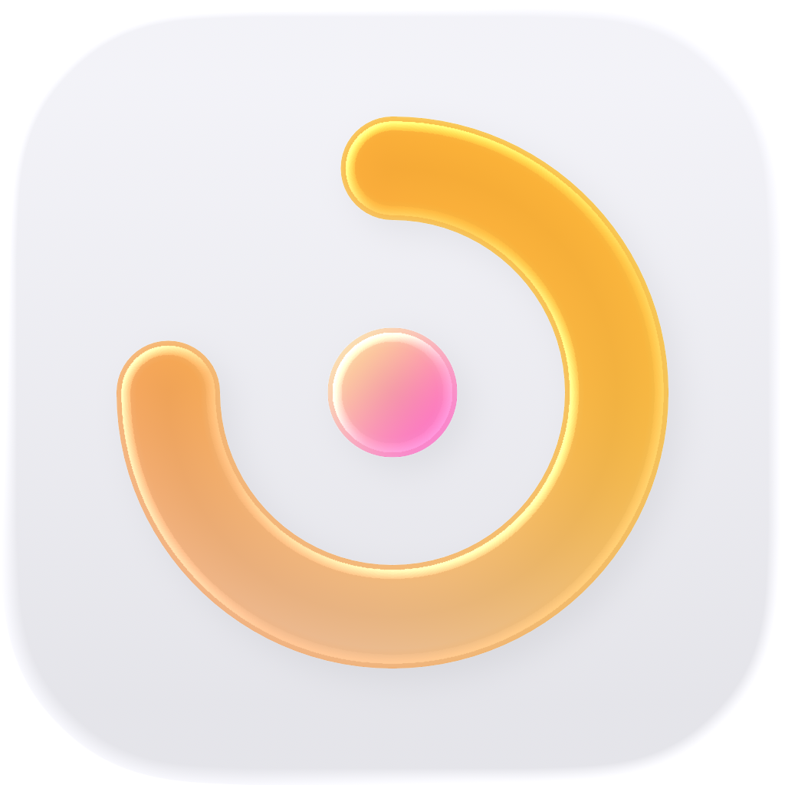

<p align="center">
  
</p>

<h1 align="center">Chrona</h1>

<p align="center">
  <a href="https://github.com/FoXLinne/ChronaApp/releases">
    
  </a>
  <a href="https://github.com/FoXLinne/ChronaApp/stargazers">
    
  </a>
  <a href="https://github.com/FoXLinne/ChronaApp/blob/dev/1.0.5/LICENSE">
    
  </a>
</p>

***

## 功能

### 计时模式

| 模式 | 说明 |
| --- | --- |
| **番茄钟** | 两种周期可选：专注 25 分钟，休息 5 分钟。专注 50 分钟，休息 10 分钟。 |
| **倒计时** | 专注时长范围为 1 至 300 分钟 |
| **正向计时** | 记录专注时长，时长无上限 |

### 任务管理

| 操作 | 内容 |
| --- | --- |
| 管理任务 | 创建、编辑、排序和搜索专注任务 |
| 设置任务 | 选择计时模式、专注时长和背景主题 |
| 设置完成状态的显示方式 | 选择是否置顶已完成任务，选择是否显示删除线 |
| 查看完成次数 | 查看每天的任务完成次数 |

### 专注统计

| 内容 | 范围或选项 |
| --- | --- |
| 专注记录 | 按日、周或月查看 |
| 统计指标 | 专注次数、总时长、日均时长和任务分布 |
| 统计图表 | 月度趋势和专注热力图 |
| 统计卡片 | 调整顺序、显示状态和展开状态 |

### 实时活动与通知

| 功能 | 内容 |
| --- | --- |
| 实时活动 | 在灵动岛和锁定屏幕查看进行中的专注状态 |
| 专注提醒 | 设置每日提醒及其时间 |
| 计时选项 | 设置沉浸模式、屏幕常亮和严格专注 |

### 小组件

- 查看今日专注时长
- 查看选定的倒数日事件
- 查看月度专注热力图

### 数据管理

| 操作 | 内容 |
| --- | --- |
| 保存数据 | 在设备本地保存任务、专注记录、倒数日和应用设置 |
| 导入和导出 | 使用 JSON 备份文件 |
| 检查备份 | 导入时检查版本和完整性 |
| 清除数据 | 在设置中清除应用数据 |

### 倒数日

- 管理日期为今天、未来或过去的事件
- 设置事件的具体时间
- 设置事件提醒

### 个性化

| 内容 | 选项或操作 |
| --- | --- |
| 个人资料 | 设置头像、昵称和个人签名 |
| 外观 | 选择浅色、深色或跟随系统 |
| 签到 | 每日签到，查看连续签到记录 |
| 任务背景 | 选择背景主题 |

### 多语言

- 简体中文
- 繁體中文
- English
- 日本語

***

## 项目结构

```
ChronaApp/
├── Chrona/              # iOS 应用
│   ├── Models/          # 任务、设置、专注记录与倒数日模型
│   ├── ViewModels/      # 应用状态管理
│   ├── Views/           # SwiftUI 页面与共享组件
│   ├── Services/        # 计时、持久化、通知与系统服务
│   └── Resources/       # 本地化字符串与资源
├── ChronaWidget/        # 小组件与实时活动
├── Chrona.xcodeproj/    # Xcode 项目
├── LICENSE
└── README.md
```

## 技术栈

- **编程语言**：Swift 6
- **界面框架**：SwiftUI
- **最低系统版本**：iOS 27.0

## 构建要求

- Xcode 27.0 或更新版本
- iOS 27.0 或更新版本的设备

### 构建步骤

1. 在 Xcode 中打开 `Chrona.xcodeproj`。
2. 选择 `Chrona` 构建方案（Scheme）。
3. 选择运行设备。
4. 按 `Cmd + R`。Xcode 构建并运行应用。

## 许可证

[Apache License 2.0](LICENSE)

***

<p align="center">
  <a href="https://github.com/FoXLinne/ChronaApp">
    
  </a>
</p>
